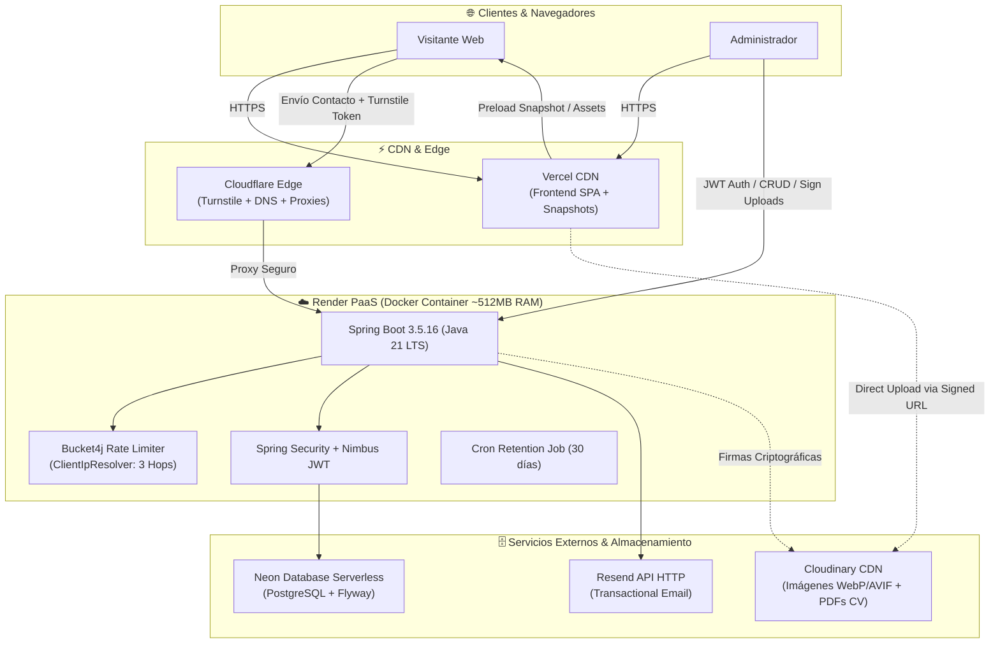

# 🚀 Rodrigo Del Villar — Portafolio Profesional Full-Stack

[](https://rodrigodvillar.com)
[](https://api.rodrigodvillar.com)
[](https://openjdk.org/)
[](https://spring.io/projects/spring-boot)
[](https://react.dev/)
[](https://www.typescriptlang.org/)
[](https://threejs.org/)

Bienvenido al repositorio del portafolio profesional de **Rodrigo Del Villar**. Este proyecto no es una simple landing page estática: es una plataforma web completa de grado de ingeniería diseñada con arquitectura desacoplada, alta resiliencia ante límites de infraestructura cloud gratuita, rendimiento adaptativo y experiencias interactivas modernas.

🌐 **Sitio en Producción:** [rodrigodvillar.com](https://rodrigodvillar.com)  
📖 **API & Swagger Docs:** [api.rodrigodvillar.com/swagger-ui.html](https://api.rodrigodvillar.com/swagger-ui.html)

---

## 🌟 Características Destacadas

### 🎨 Experiencia Visual e Interactiva (Frontend)
- **Rendimiento Adaptativo & Modo Lite:** Motor propio con `usePerformanceTier` que mide en tiempo real los FPS mediante `requestAnimationFrame` y evalúa capacidades de hardware (`deviceMemory`, `hardwareConcurrency`). Si detecta bajo rendimiento o dispositivos sin GPU, degrada suavemente a `[data-perf="lite"]` sin alterar el contenido.
- **Hero 3D con Three.js:** Campo de partículas interactivo que reacciona al puntero del ratón, cargado con `import()` dinámico y compuertas estrictas (solo escritorio, WebGL2 y tier full). En móviles jamás descarga la librería 3D.
- **Bento 3D World (Mini-Mundo Low-Poly):** Habitación interactiva 3D con física en tiempo real (`cannon-es`), efectos de sonido sintetizados al golpear objetos y paleta nocturna aislada.
- **Carrusel Coverflow de Proyectos:** Implementado con Swiper 14, soporte responsive (1-3 proyectos en showcase, 4+ en coverflow interactivo) y modal de detalle con galería multimedia (`ProjectDetailModal` con imágenes y videos de YouTube).
- **Sound Engine Generativo:** Audio sintetizado mediante Web Audio API puro para interacción de clics, teclado, switches y sonidos ambientales lofi sin usar assets pesados ni archivos con copyright.
- **Terminal Interactiva & Command Palette:** Modal estilo consola (`>_`) con comandos interactivos y paleta tipo Spotlight (`Ctrl + K` / `Cmd + K`).
- **Tema Claro / Oscuro & i18n:** Soporte nativo para modo oscuro y claro con tokens CSS sin FOUC (Flash of Unstyled Content), e internacionalización completa (Español / Inglés) con `react-i18next`.

### 🛡️ Seguridad, Resiliencia y Backend (Spring Boot)
- **Estrategia SRE de Snapshot (Zero Cold-Start Lag):** El backend en Render Free duerme tras inactividad. El frontend utiliza un snapshot estático generado durante el build para servir proyectos y CV al instante (LCP < 1.2s y CLS estricto de 0), revalidando en segundo plano cuando la API despierta.
- **Panel de Administración Protegido:**
  - Login seguro con JWT *stateless* (`HS256`). Access token en memoria y Refresh token en Cookie segura `HttpOnly` + `Secure` + `SameSite=Lax`.
  - CRUD integral de proyectos: orden de visualización, multimedia múltiple (`media[]`, máx. 15 entre imágenes Cloudinary y videos de YouTube) y enlaces a múltiples repositorios (`repos[]`, máx. 5).
  - Subida directa de archivos (CV en PDF e imágenes) a Cloudinary mediante endpoints de firmas criptográficas temporales (`/api/admin/uploads/sign`), evitando que bytes pesados saturen el servidor.
  - Bandeja de entrada para revisar y gestionar mensajes de contacto recibidos.
- **Protección Anti-Spam y Rate Limiting:**
  - Validación de humanos con **Cloudflare Turnstile** con arquitectura *fail-closed*.
  - Rate limiting por IP del cliente con **Bucket4j + Caffeine**.
  - **Mitigación de IP Spoofing (ADR 12):** `ClientIpResolver` adaptado a la topología de Render (`TRUSTED_HOPS = 3`), normalización de prefijos IPv6 (`/64`) y fallback a socket TCP nativo.
- **Contacto Resiliente:** Los mensajes se guardan en estado `PENDING` antes de despacharse vía API HTTP de Resend (sin puertos SMTP bloqueados). Job diario de retención que purga mensajes de más de 30 días.

---

## 🏗️ Arquitectura del Sistema



---

## 💻 Tech Stack

| Capa | Tecnologías |
|---|---|
| **Frontend** | React 19, TypeScript (Strict), Vite, Tailwind CSS v4, Motion (`motion/react`), Three.js, Cannon-es, Swiper 14, TanStack Query, react-i18next, Lenis Scroll. |
| **Backend** | Java 21 LTS, Spring Boot 3.5.16, Spring Security, Spring Data JPA, Flyway Migrations, Bucket4j, Caffeine Cache, Springdoc OpenAPI 2.8.x. |
| **Base de Datos** | PostgreSQL 16 (Neon Serverless en producción, Docker local). |
| **Infraestructura** | Vercel (Frontend Hosting + Edge Caching), Render (Dockerized Backend), Cloudinary (Media CDN), Resend (API Email), Cloudflare (DNS, Anti-Bot). |
| **Testing & CI/CD** | Vitest, Testing Library, JSDOM, JUnit 5, Mockito, Testcontainers, GitHub Actions CI. |

---

## 📂 Estructura del Repositorio (Monorepo)

```text
├── backend/                  # API REST en Spring Boot 3.5.16 (Java 21)
│   ├── src/main/java/        # Código fuente estructurado por features
│   ├── src/main/resources/   # Configuración de entornos y migraciones Flyway (db/migration)
│   ├── Dockerfile            # Construcción multi-stage Alpine optimizada para <512MB RAM
│   └── pom.xml               # Dependencias Maven con BOM estricto
├── frontend/                 # Aplicación SPA en React 19 + TypeScript
│   ├── src/
│   │   ├── components/       # Componentes visuales compartidos (Layout, Modales, UI)
│   │   ├── features/         # Features aisladas (hero, about, projects, contact, cv, etc.)
│   │   ├── hooks/            # Hooks de rendimiento (useCapabilities, usePerformanceTier)
│   │   ├── locales/          # Diccionarios de traducción i18n (es / en)
│   │   └── data/             # Configuración del sitio y perfiles
│   ├── scripts/              # Utilidades de Snapshot SRE y optimización de imágenes
│   └── vite.config.ts        # Configuración Vite con chunks manuales (Three, Vendor)
├── docs/                     # Registro de Ingeniería y Documentación Técnica
│   ├── ADRs (DECISIONS.md)   # Decisiones de Arquitectura documentadas
│   ├── PERFORMANCE.md        # Protocolo formal de medición de rendimiento (Lighthouse/FPS)
│   ├── SPRINT_LOG.md         # Bitácora histórica de ejecución de Sprints (S0 - S13)
│   └── API_CONTRACT.md       # Contrato de datos y endpoints de la API
└── docker-compose.yml        # Entorno local reproducible con PostgreSQL
```

---

## 🛠️ Puesta en Marcha Local

### Prerrequisitos
- Git
- Node.js ≥ 20.x y npm
- Java JDK 21
- Docker y Docker Desktop

### 1. Clonar el repositorio
```bash
git clone https://github.com/Villa19d/portfolio.git
cd portfolio
```

### 2. Base de Datos Local
Inicia el contenedor de PostgreSQL local:
```bash
docker compose up -d db
```

### 3. Backend (Spring Boot)
Copia las variables de entorno de ejemplo:
```bash
cd backend
cp .env.example .env   # En Windows PowerShell: Copy-Item .env.example .env
./mvnw spring-boot:run
```
La API estará disponible en `http://localhost:8080` (Swagger en `http://localhost:8080/swagger-ui.html`).

### 4. Frontend (React 19)
En una nueva terminal:
```bash
cd frontend
cp .env.example .env
npm install
npm run dev
```
La aplicación abrirá en `http://localhost:5173`.

---

## 📊 Medición y Rendimiento (Performance)

El proyecto cuenta con un protocolo formal de auditoría (`docs/PERFORMANCE.md`):
- **Presupuesto inicial de JavaScript:** `< 150 KB gzip` para el chunk inicial.
- **Three.js diferido:** Lazy load condicionado que aísla el chunk de Three.js (~150 KB gzip) para no penalizar el First Contentful Paint.
- **CLS (Cumulative Layout Shift):** 0 en producción gracias a reservas dimensionales y la estrategia de snapshot estático.

---

## 👨‍💻 Autor

**Rodrigo Del Villar**  
Desarrollador Full-Stack  
- **Sitio Web:** [rodrigodvillar.com](https://rodrigodvillar.com)  
- **LinkedIn:** [linkedin.com/in/luis-rodrigo-del-villar-morales](https://www.linkedin.com/in/luis-rodrigo-del-villar-morales-720810325/)  
- **GitHub:** [@Villa19d](https://github.com/Villa19d)  
- **Contacto:** luisrodrigo1005@gmail.com

---
*Hecho con dedicación, buenas prácticas de ingeniería y código limpio.*
